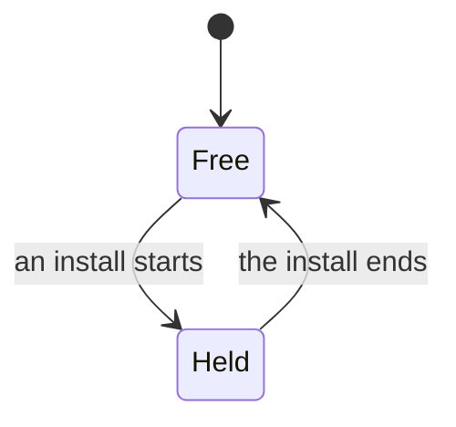

# install lock: who owns it

## Terms

**Goal.** The design as it stands, in short paragraphs. A blank shows the answer to a decision, or its plan while it is open: the lock is {?1}.

## Decisions

### 1 · Lock owner · your call

The tension, in one or two sentences.

- a · **harness owns the lock** · plan
  + What you gain.
  - What you pay.
- b · **each package has its own lock**
  - What you pay.

Plan: a, and why, in one sentence.

### 2 · Stale lock · my call

- a · **a dead PID is taken over** · plan
  + One line of evidence: a test, a spike, or a file and line.
- b · **a timeout**

Answer: a
> "ok"

## Settled

- **A decision from an earlier record or from chat.**
  > "the user's exact words"
